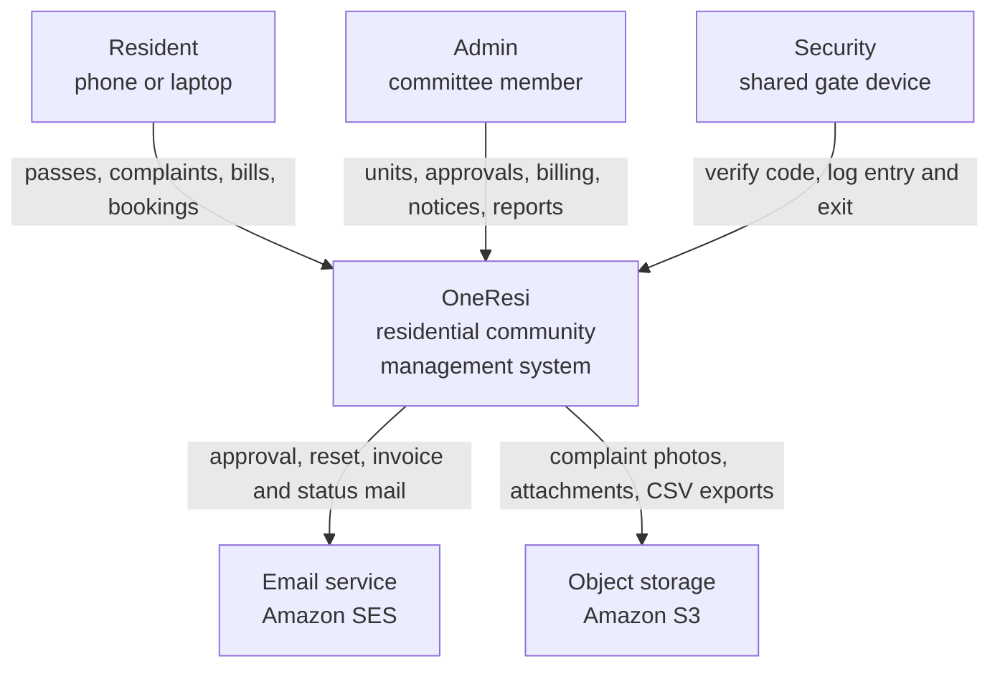
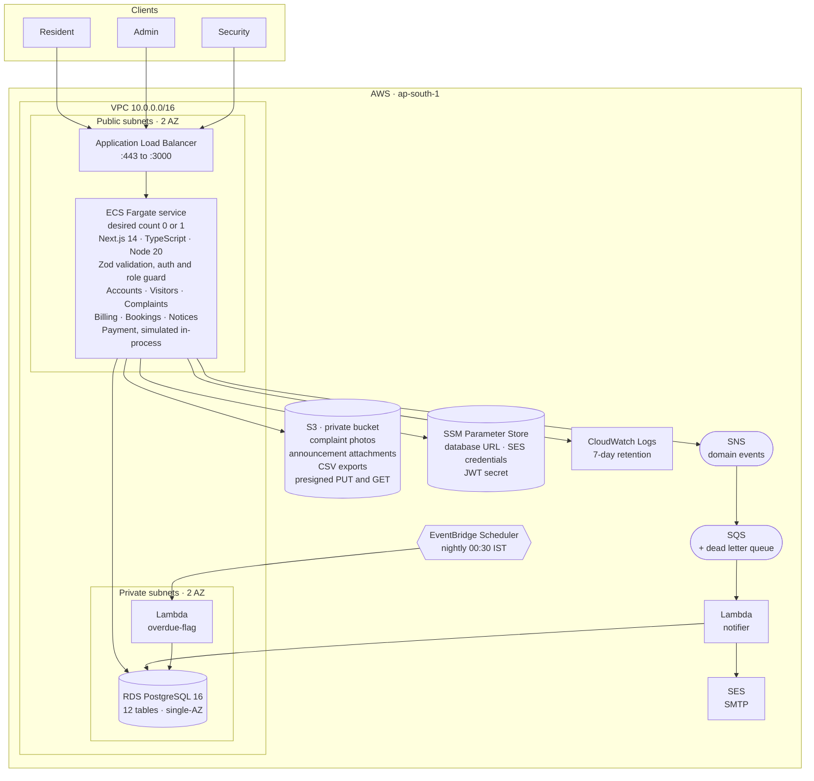
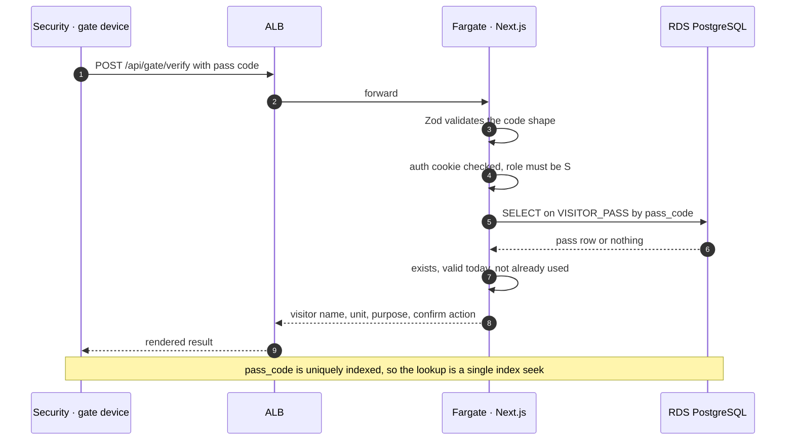
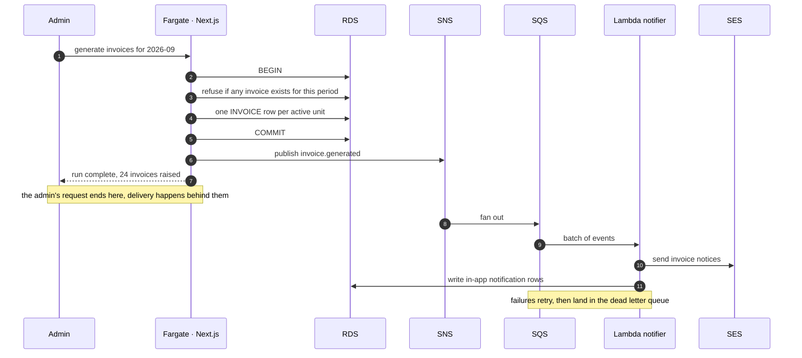
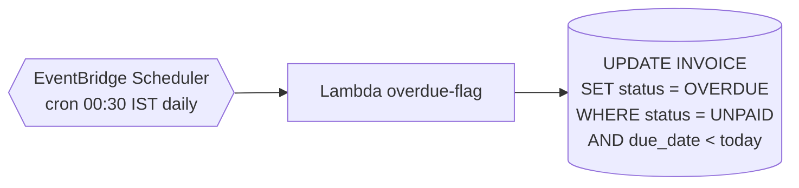
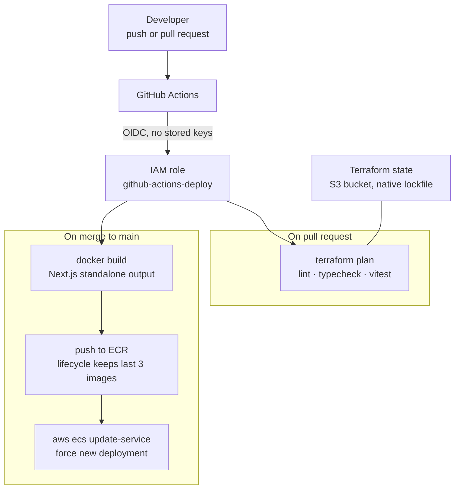
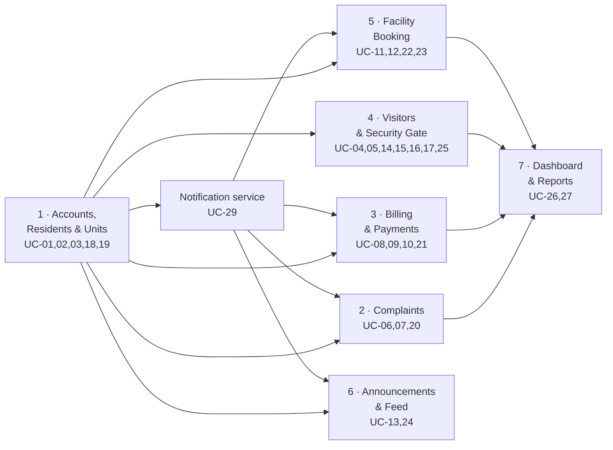

# OneResi — Architecture

Implementation architecture for the system specified in the OneResi SRS, 29 use cases and
UML models. The application tier is unchanged from the technology stack submitted in the
DA1 Review 1 deck. Only the deployment tier moved, from Vercel to AWS provisioned with
Terraform — see [adr/0001](adr/0001-aws-instead-of-vercel.md).

The three tiers on the submitted architecture slide map onto AWS directly:

| Submitted tier | Declared technology | Runs as |
|---|---|---|
| Presentation | React with Next.js, Tailwind CSS | Server-rendered by the Next.js process, reached through an Application Load Balancer |
| Application | Node.js API routes | A single ECS Fargate task; the same six services — Accounts, Visitors, Complaints, Billing, Bookings, Notices |
| Data | PostgreSQL through Prisma | RDS for PostgreSQL 16, private subnets |

## System context

Three human actors, one system, two external services. The Payment Gateway actor from the
submitted use case diagram is gone; payment is simulated in-process — see
[adr/0002](adr/0002-payment-is-simulated.md).

## AWS runtime architecture

Region `ap-south-1` (Mumbai). Everything below is provisioned by Terraform.

### Why this shape

**Containers rather than Lambda.** Next.js runs unmodified in a container, and Prisma keeps
a normal persistent connection pool. Putting Next.js on Lambda needs an adapter such as
OpenNext, and Prisma's connection model then needs RDS Proxy at roughly $15 a month to
survive concurrent invocations. Both are complexity bought to solve an idle-cost problem
that `desired_count = 0` already solves.

**No NAT Gateway.** A NAT Gateway is about $41 a month with no free tier and is the usual
way a student AWS account quietly drains. The Fargate task therefore sits in a public subnet
with a public IP, and its security group accepts traffic only from the load balancer's
security group. RDS stays in private subnets and accepts only the task's security group.
This is less textbook than putting every workload in a private subnet, and it is recorded
as a limitation rather than hidden.

**Two Lambdas, not a second container.** The notifier and the overdue-flag job are small,
event-driven and idle almost all the time, which is exactly what Lambda is for and costs
nothing at this volume.

**Parameter Store rather than Secrets Manager.** Identical job at this scale; Secrets Manager
bills $0.40 per secret per month and Parameter Store SecureString is free.

## Synchronous request path

Gate code verification is the tightest requirement in the SRS — a result within two seconds
(5.1). It is also the shortest path through the system, which is why it fits.

## Asynchronous notification path

UC-29 alternative flow 3a requires that if the email service is unavailable, the failure is
logged and the calling use case still completes. Publishing an event instead of calling SES
inside the request handler makes that a property of the architecture rather than something
each handler has to remember. The monthly invoice run cannot fail because SES was down.

SNS has two subscribers, which is what justifies it sitting in front of the queue rather than
publishing to SQS directly: outbound email, and the in-app notification that UC-05 needs when
a walk-in visitor is waiting on a resident's decision.

## Scheduled work

One scheduled job. UC-08 step 4 flags any invoice past its due date as overdue, and the
`INVOICE.Status` constraint carries an `OVERDUE` value, so the transition is stored rather
than derived at read time.

## Delivery pipeline

No long-lived AWS keys anywhere. GitHub Actions assumes a role through an OIDC trust
relationship, so there is nothing to leak or rotate.

Terraform 1.10 and later locks state in S3 natively with `use_lockfile = true`, so there is no
DynamoDB lock table.

## Modules

Eight modules, 29 use cases, built in dependency order. Arrows mean *needs*.

Module numbering here is build order; the SRS feature numbers are 4.1 through 4.8.
The notification service is not one of the eight — it is UC-29, included by six use cases,
so it is built alongside module 1.

## Service selection

Every service is here because a use case or a non-functional requirement asks for it.

| Requirement | Service | Free tier position |
|---|---|---|
| Complaint photos (UC-06), announcement attachments (UC-24), CSV exports (UC-27) | S3, private bucket, presigned PUT and GET so bytes never pass through the app | 5 GB, 12 months |
| Email for UC-03, 19, 20, 21, 23, 24 | SES over SMTP, driven by Nodemailer as declared in the deck | ~3,000 messages a month, 12 months |
| UC-29 must not fail its caller | SNS topic, SQS queue with dead letter queue, notifier Lambda | 1M publishes and 1M queue requests, permanently free |
| Walk-in approval reaching the resident (UC-16 to UC-05) | Same path, second subscriber writing in-app notifications | free |
| Overdue invoice flagging (UC-08) | EventBridge Scheduler and a Lambda | negligible |
| Gate lookup under 2 seconds (SRS 5.1) | RDS with the unique index already on `pass_code` | free tier |
| Dashboard aggregates (UC-26) | RDS aggregate queries, Recharts on the client | free |
| Secrets | SSM Parameter Store SecureString | free |
| Application runtime | ECS Fargate and ECR | Fargate has no free tier; ECR 500 MB for 12 months |
| Public ingress | Application Load Balancer | 750 hours a month, 12 months |
| Relational store | RDS `db.t4g.micro`, 20 GB | 750 hours a month, 12 months |
| Logs and alerting | CloudWatch Logs, alarms to an SNS ops topic, AWS Budgets | 5 GB ingest permanently free; Budgets free |

Free tier terms change; the figures above are worth confirming in the billing console rather
than trusted from this document.

## Deliberately not used

Worth being able to answer, because these are the obvious questions.

**Cognito.** Free for 50,000 monthly users, but UC-01 and UC-03 specify bcrypt hash
comparison and our own single-use reset tokens, and the submitted deck commits to a
self-issued JWT in an HTTP-only cookie. Adopting Cognito would falsify three submitted
documents to avoid code that has to exist anyway.

**DynamoDB.** `UQ_INVOICE_UNIT_PERIOD` and `UQ_BOOKING_SLOT` are what actually prevent double
billing and double booking. Those are database guarantees; a document store would mean
reimplementing both by hand in application code.

**NAT Gateway and interface VPC endpoints.** Around $41 and $7 a month respectively, no free
tier, and avoidable here. See *Why this shape*.

**Secrets Manager.** $0.40 per secret per month for what Parameter Store does free.

**CloudFront.** Genuinely free at this volume and easy to add later, but with the load balancer
free for twelve months it buys nothing yet.

**SNS for user-facing email.** SNS email subscriptions need each recipient to confirm a
subscription and arrive as plain untemplated text with an AWS footer. SES is the mailer; SNS
is the event bus.

**SMS and push.** SRS 3.4 excludes both from v1.0, and India's DLT registration makes
transactional SMS impractical for a student project.

## Cost

With the free tier active, Fargate is the only line item that bills.

| | Running continuously | Scaled to zero between sessions |
|---|---|---|
| Fargate 0.25 vCPU / 0.5 GB | ~$9 / month | a few cents per session |
| Everything else | $0 under free tier | $0 |

An AWS Budgets alarm with a $5 threshold is the first resource Terraform creates, before
anything that can cost money.

## Stated limitations

These belong in the final report as limitations rather than being left for a reviewer to find.

- RDS is single-AZ. There is no failover; recovery is a restore from automated snapshot.
- The Fargate task runs in a public subnet with a security group restricting ingress to the
  load balancer, rather than in a private subnet behind a NAT Gateway.
- Payment is simulated. No gateway integration and no real money movement — see
  [adr/0002](adr/0002-payment-is-simulated.md).
- SES begins in sandbox, so mail is deliverable only to verified addresses until production
  access is granted. Demo mailboxes are verified explicitly.
- Security is a single shared account per society, so gate entries are attributable to the
  gate rather than to an individual guard.
- One society per deployment. Nothing in the schema is multi-tenant.

## Open decisions

Unresolved at the time of writing, carried from the module 1 discussion.

1. Whether the schema source of truth is the union of `er.mmd` and the submitted DDL — see
   [adr/0003](adr/0003-schema-source-of-truth.md), currently proposed rather than accepted.
2. Whether an Admin may also hold a resident account, or whether a committee member keeps two
   separate logins.
3. Whether Admin and Security accounts are seeded, or whether a staff-account flow is added to
   UC-18's screen.
4. The maximum registered occupants per unit, which UC-02 alternative flow 4b relies on and no
   document states.
5. Whether `UNIT.Type` becomes a fixed enumeration.

