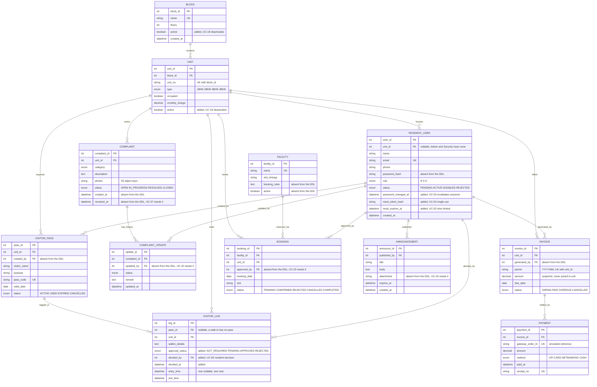

# GrihaOne — Data Model

Twelve entities, as submitted. This document is the reconciled version of two artifacts that
do not agree with each other, plus the corrections the use cases require.

## The problem being reconciled

`er.mmd` and `grihaone_ddl.sql` describe different models. The DDL was written to import cleanly
into Oracle SQL Developer Data Modeler and produce connector lines, and in the process it drops
columns the ER model carries — including `RESIDENT_USER.password_hash`, without which no one can
log in. Meanwhile the ER model omits constraints the DDL states precisely.

Proposed rule: **every column from `er.mmd`, every constraint from the DDL, plus the additions
listed below that individual use cases require.** See
[adr/0003](adr/0003-schema-source-of-truth.md).

## Reconciled model



## Columns the DDL dropped

Present in `er.mmd`, absent from `grihaone_ddl.sql`. None are decorative — the third column
names the use case that fails without them.

| Table | Column | Required by |
|---|---|---|
| RESIDENT_USER | `password_hash` | UC-01 step 3, verifying against the stored bcrypt hash |
| BLOCK | `created_at` | audit only |
| UNIT | `occupied` | UC-02 alternative flow 4b |
| VISITOR_PASS | `created_by` | UC-04, attributing a pass to the resident who raised it |
| COMPLAINT | `created_at`, `resolved_at` | UC-07, the seven-day reopen window is measured from resolution |
| COMPLAINT_UPDATE | `updated_by` | UC-20 step 3, "with the Admin's identity" |
| INVOICE | `generated_by` | UC-21, attributing a billing run |
| FACILITY | `booking_rules`, `active` | UC-22 |
| BOOKING | `approved_by` | UC-23 step 4 |
| ANNOUNCEMENT | `attachment` | UC-24 step 3 |

## Two constraints that contradict a use case

**`VISITOR_LOG.Entry_Time` is `NOT NULL`.** UC-16 creates a walk-in record in Pending state, and
the comment on that use case states entry is recorded only after resident approval. So the row
has to exist before an entry time is known. `entry_time` must become nullable, and the added
`approval_status` carries the state the row is in until then.

**`UQ_BOOKING_SLOT UNIQUE (Facility_ID, Booking_Date, Slot)` makes UC-12 impossible.** Cancelling
a booking is supposed to release the slot so it becomes bookable again, but a plain unique
constraint leaves the cancelled row occupying that slot permanently — nobody can ever book it.
The fix is a partial unique index restricted to live bookings:

```sql
CREATE UNIQUE INDEX uq_booking_live_slot
  ON booking (facility_id, booking_date, slot)
  WHERE status IN ('PENDING', 'CONFIRMED');
```

Prisma cannot express a filtered unique index in `schema.prisma`, so this goes into a
hand-edited migration. Worth knowing before the booking module is built rather than after.

## Where the DDL is better than the ER model

`UQ_INVOICE_UNIT_PERIOD UNIQUE (Unit_ID, Period)` is exactly right, and it is what makes UC-21's
refusal to run twice for the same month a database guarantee instead of an application check
that a concurrent request could slip past. Same for `UQ_PAYMENT_ORDER`, which is what stops a
repeated payment confirmation creating a second `PAYMENT` row. Neither appears in `er.mmd`.

## Status values added

| Table | Submitted | Added | Why |
|---|---|---|---|
| RESIDENT_USER | PENDING, ACTIVE, DISABLED | REJECTED | UC-19 postcondition says an application becomes Active or Rejected |
| BOOKING | CONFIRMED, CANCELLED, COMPLETED | PENDING, REJECTED | UC-11 creates bookings Pending; UC-23 can reject |
| VISITOR_LOG | none | NOT_REQUIRED, PENDING, APPROVED, REJECTED | UC-05's decision had nowhere to live |

## Smaller notes

`COMPLAINT.photos` is a single `VARCHAR2(500)`, so up to three S3 object keys are stored
delimited in one column rather than in a child table. Normalising it would be better design but
would add a thirteenth entity to a model already submitted with twelve, so it stays as
specified.

`COMPLAINT` has no `raised_by` in either artifact, so a complaint is attributed to a unit rather
than to a person in it. That is consistent with SRS 5.3, where a resident sees their own unit's
records, but it means the household cannot tell which occupant filed it. Open question rather
than a defect.

`INVOICE.amount` is written at generation time and never joined back to `UNIT.monthly_charge`.
This matters: if the monthly charge changes in March, historical invoices must not reprice. The
submitted schema already supports this correctly; the implementation just has to snapshot rather
than join.

## For the final report

Once these are agreed, `grihaone_ddl.sql` should be regenerated from the reconciled model so the
report's ER figure and the running database match. The delta tables above are the errata list to
cite when explaining why the submitted DDL and the delivered schema differ.


